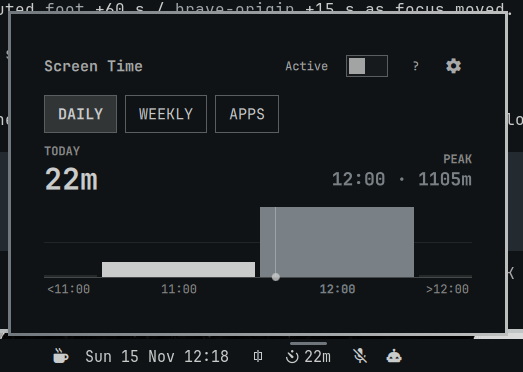

# omasot — Screen Time Tracker for Omarchy

A lightweight screen time tracker plugin for the [Omarchy](https://omarchy.org/) shell bar. Shows your daily screen-on time at a glance and provides an hourly breakdown chart when clicked.

## Features

- **Bar widget** — displays total screen time today (e.g. `2h 34m`); on a left/right bar the slot is one icon wide, so it stacks the screen-time glyph over `3h` / `38m` instead of the horizontal label
- **Daily view** — hourly bars with a right-hand value axis; unused small hours collapse into one narrow `0–9` block so the hours you use get the width
- **Weekly view** — Mon–Sun bars with a value axis, week total and share of 168h, and a FOCUSED / OVERALL switch: focused counts only time attributed to an app, overall adds time with no focused app
- **App stats** — per-app usage for today or any day you click in the weekly chart (top-6 + Other with time and % share, plus an unattributed / other row so the day reconciles); Show more expands all
- **Identity modes** — Simple records window class only (e.g. zen/foot); Smart resolves the foreground process inside terminals (e.g. opencode not foot), uses the game title for steam_app_<id>, and shortens reverse-DNS names
- **Private by design** — window titles are never stored except Steam game titles; fully local, no network access
- **Tracking Modes** — use the mode switch in the panel to switch between "Active" (counts time while the screen is on, unlocked and a window is focused) and "Always" (counts all screen-on time, whether or not a window is focused)
- **Theme-aware** — adapts colors to your current Omarchy theme
- **Lightweight** — simple Python backend, no daemons or databases

## Screenshot



## Requirements

- **Omarchy Quattro** with Quickshell
- **Python 3** (pre-installed on Omarchy)

## Installation

```bash
omarchy plugin add https://github.com/kamal-v8/omasot.git --enable
```

This clones the plugin and enables it in your bar automatically.

Alternatively, you can manually clone and configure:

```bash
git clone https://github.com/kamal-v8/omasot.git ~/.config/omarchy/plugins/omasot
```

Then add it to your bar in `~/.config/omarchy/shell.json`:

```json
{
  "id": "omasot"
}
```

The shell hot-reloads on save — no restart needed.

## Usage

Click the widget to open the details panel. Press Escape to close it. Click the
mode switch in the top-right of the panel to switch between `Active` and
`Always` tracking.

The Weekly view shows the week at a glance; the Apps view breaks a day down:

- Use the week pager (`‹ Sep 7 – 13, 2026 · W37 ›`) to move between weeks. Bars show Mon–Sun totals with the week total and share of 168h. Switch FOCUSED / OVERALL to compare app-attributed time against total screen-on time; hovering a bar always shows both.
- Click a day to see its top apps. Each row shows time and % share; top-6 plus Other are shown by default and Show more expands all.

Click the gear icon for Settings:

- Weekly view toggle
- App view toggle
- App icons toggle
- Tracking mode: Off / Simple / Smart
- History retention: 30 / 90 / 180 / 365 days (default 365, max 365)

## Removal

Remove from your bar layout in `~/.config/omarchy/shell.json`, then remove the plugin:

```bash
omarchy plugin remove omasot
```

Optionally remove the state file:

```bash
rm ~/.local/state/screentime.json
```

## How It Works

1. A background **service** ticks every 5 seconds. Each tick it asks Hyprland whether you are present — the display is on (`hyprctl -j monitors` → `dpmsStatus`) and the session is not locked (`solitaryBlockedBy` containing `LOCK`) — and whether a window is focused (`hyprctl activewindow`). It then calls `tracker.py tick` to credit the seconds that really elapsed, so partial minutes are counted instead of being rounded to whole minutes.
2. **Active** credits those seconds only while a window is focused; **Always** credits every second the screen is on, even with no window focused. Idle and input activity are no longer used to decide what counts: watching a video counts, an empty desktop does not.
3. The **bar widget** calls `tracker.py` (no args) on a timer to read today's total and display it.
4. Clicking the widget opens a **panel** with a 24-hour bar chart of today's hourly totals.
5. The mode switch in the panel switches between **Active** (screen on, unlocked, window focused) and **Always** (all screen-on time).
6. Data is stored in `~/.local/state/screentime.json` as a simple JSON object keyed by date and hour, with per-day `_apps` seconds for per-app totals. History is stored in **seconds** (schema 2); old minute-based history is migrated automatically on first run by multiplying the old hourly buckets by 60. Old days are pruned according to the retention setting (30/90/180/365 days, default 365, max 365). No network access, no elevated privileges.
7. Per-app attribution follows the focused window, regardless of mouse or keyboard activity. Disabled (Off) mode attributes nothing.
8. App identity depends on tracking mode: Simple records window class only (e.g. zen/foot); Smart resolves the foreground process inside terminals (e.g. opencode not foot), uses the game title for `steam_app_<id>`, and shortens reverse-DNS names. Window titles are never stored except Steam game titles. All resolution is local with no network access.
9. Attribution splits at midnight so seconds before and after midnight count toward their respective days.

## External Dependencies

| Dependency | Purpose | Included in Omarchy? |
|------------|---------|---------------------|
| Python 3 | Data recording and reading | Yes |
| hyprctl | Presence and focused-window detection | Yes |

## License

[MIT](LICENSE)
